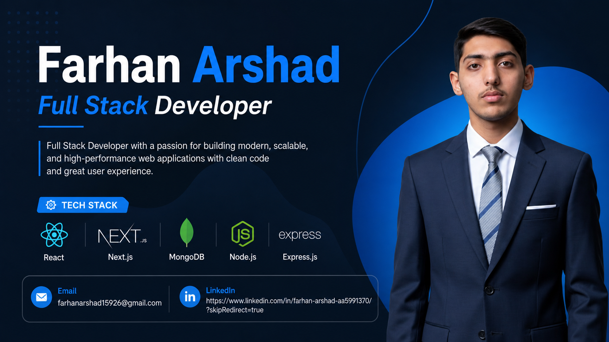

#Farhan Arshad

  

  <b>Hi, I'm Farhan Arshad!</b> 
  <b>MERN Stack & Full-Stack Developer</b> building scalable, performant, and reliable web applications. 
  Passionate about turning complex requirements into clean, efficient code and seamless user experiences.

  

---

## About Me 

I specialize in building production-ready, full-stack web applications with modern architecture, clean code practices, and smooth user interfaces.

- **Full-Stack Application Development** — End-to-end web software engineering, converting concepts into production-grade systems using the MERN ecosystem.
- **Responsive & Intuitive UI Engineering** — Crafting pixel-perfect, accessible, and fast client-side applications with React and Tailwind CSS.
- **Robust Backend Architecture** — Designing RESTful APIs, modular server logic, and scalable backend workflows using Node.js and Express.
- **Data Modeling & Optimization** — Structuring database schemas with MongoDB and Supabase, optimized for performance and query efficiency.
- **Authentication & Application Security** — Implementing secure authorization workflows including JWT, OAuth, and Role-Based Access Control (RBAC).
- **Deployment & Cloud Hosting** — Setting up seamless CI/CD pipelines, environment configurations, and deployment across Vercel, Railway, and VPS environments.

---

## Tech Stack

  

---

## Connect With Me

  

  

   

  

  <b>Have a project in mind? Let's build something amazing together!</b> 
  <a href="mailto:farhanarshad15926@gmail.com">farhanarshad15926@gmail.com</a>

 

  

 

---
